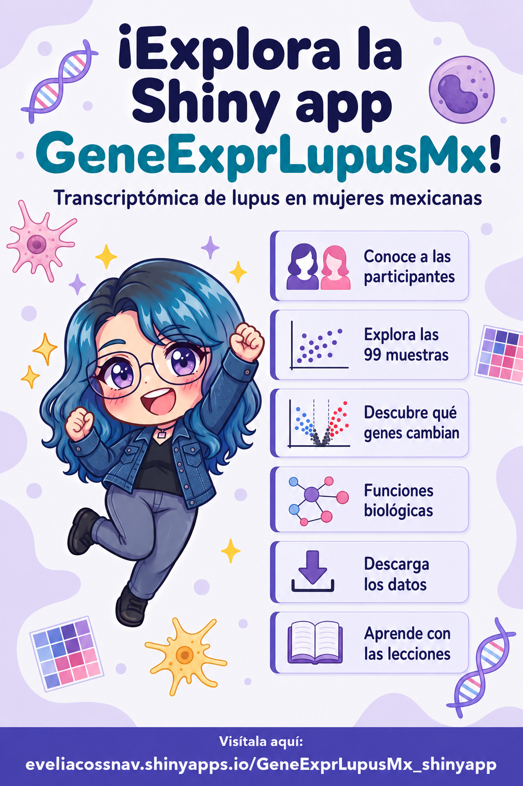
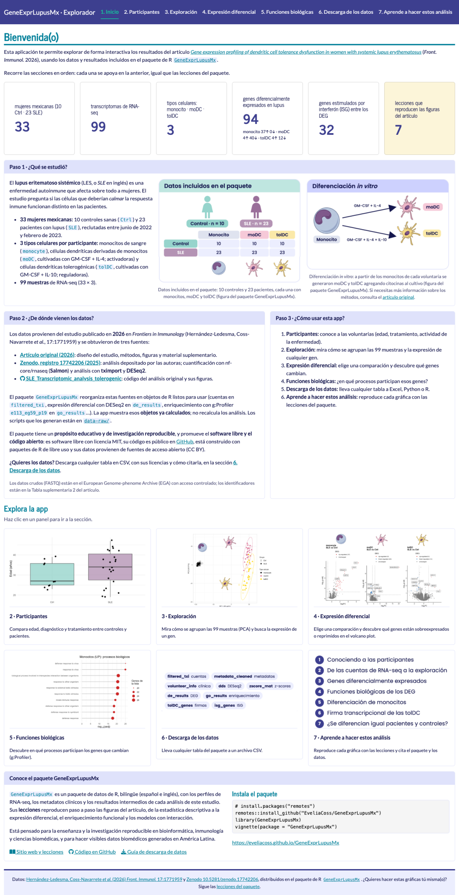
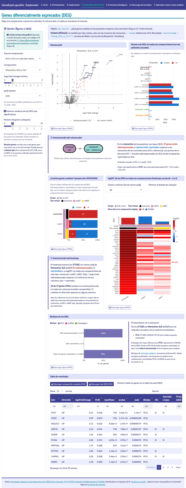

# GeneExprLupusMx · Explorador (Shiny)

Aplicación Shiny para explorar de forma interactiva los resultados del artículo
[Hernández-Ledesma, Coss-Navarrete *et al.* (2026) *Front. Immunol.* 17:1771959](https://www.frontiersin.org/journals/immunology/articles/10.3389/fimmu.2026.1771959/full),
con los datos del paquete de R [`GeneExprLupusMx`](https://github.com/EveliaCoss/GeneExprLupusMx).
Cada gráfica enlaza a la [lección del paquete](https://eveliacoss.github.io/GeneExprLupusMx/) que enseña a construirla paso a paso.

**▶ Abre la app:** <https://eveliacossnav.shinyapps.io/GeneExprLupusMx_shinyapp/>

<p align="center">
  <a href="https://eveliacossnav.shinyapps.io/GeneExprLupusMx_shinyapp/">
    
  </a>
</p>

**Datos públicos:** todos los datos que muestra la app son públicos y de acceso abierto. Provienen del artículo
original y del análisis depositado en Zenodo (ambos con licencia CC BY), reorganizados en el paquete `GeneExprLupusMx`.
Los datos crudos de secuenciación (FASTQ) están en el European Genome-phenome Archive (EGA) con acceso controlado;
la app no los usa.

> *English:* An interactive Shiny app to explore the transcriptomic results of the study on dendritic cell
> tolerance in Mexican women with systemic lupus erythematosus (*Front. Immunol.* 2026), built on the
> R data package `GeneExprLupusMx`. All data shown are public and open access (CC BY). The interface is
> currently in Spanish; an English version is planned.



## El estudio y los datos

- **33 mujeres mexicanas:** 10 controles sanas (`Ctrl`) y 23 pacientes con lupus (`SLE`).
- **3 tipos celulares por participante:** monocitos, células dendríticas derivadas de monocitos (`moDC`) y células dendríticas tolerogénicas (`tolDC`).
- **99 muestras de RNA-seq** (33 × 3).

La app muestra los **objetos ya calculados** que distribuye el paquete (`de_results`, `go_results`, `zscore_mat`…); no recalcula los análisis.

| Fuente | ¿Qué contiene? | Licencia |
|--------|----------------|----------|
| [Artículo original](https://www.frontiersin.org/journals/immunology/articles/10.3389/fimmu.2026.1771959/full) (*Front. Immunol.* 2026) | Diseño del estudio, métodos, figuras y material suplementario | CC BY |
| [Zenodo, registro 17742206](https://doi.org/10.5281/zenodo.17742206) (2025) | Análisis depositado por las autoras: nf-core/rnaseq (Salmon), tximport y DESeq2 | CC BY 4.0 |
| [SLE_Transcriptomic_analysis_tolerogenic](https://github.com/NeuroGenomicsMX/SLE_Transcriptomic_analysis_tolerogenic) | Código del análisis original y sus figuras | Sin licencia declarada |
| [GeneExprLupusMx](https://github.com/EveliaCoss/GeneExprLupusMx) | Los datos reorganizados en objetos de R, lecciones y funciones | MIT |
| European Genome-phenome Archive (EGA) | Datos crudos (FASTQ); identificadores en la Tabla suplementaria 2 del artículo | Acceso controlado |

## Secciones de la app

| Sección | ¿Qué puedes hacer? | Aprende a hacerlo en |
|---------|--------------------|----------------------|
| 1. Inicio | Conocer el estudio, de dónde vienen los datos y cómo recorrer la app | [Primeros pasos](https://eveliacoss.github.io/GeneExprLupusMx/articles/intro_es.html) |
| 2. Participantes | Comparar edad, diagnóstico y tratamiento entre controles y pacientes | [Lección 1](https://eveliacoss.github.io/GeneExprLupusMx/articles/clinical_es.html) |
| 3. Exploración | PCA con *scree plot* (elige los PCs, los tipos celulares y todos o los 500/250/100 genes más variables); expresión de un gen; *dot plot* de biomarcadores; *heatmap* de conjuntos de genes (ISG, genes de lupus, firma tolDC…), agrupando por grupo, edad, actividad de la enfermedad o uso de glucocorticoides | [Lección 2](https://eveliacoss.github.io/GeneExprLupusMx/articles/intro_RNAseq_es.html) y [Lección 3](https://eveliacoss.github.io/GeneExprLupusMx/articles/l3_DEGs_es.html) |
| 4. Expresión diferencial | 9 comparaciones (SLE vs Ctrl, diferenciación y efecto de interacción del SLE) con el modelo de DESeq2 de cada una; *volcano plot* con nombres de genes y genes resaltados; número de DEG en todas las comparaciones; interpretación con diagrama; proporción de genes sobreexpresados y reprimidos; *heatmap* de log2FC; biotipos de los DEG; tabla y descargas (CSV y PNG) | [Lección 3](https://eveliacoss.github.io/GeneExprLupusMx/articles/l3_DEGs_es.html), [5](https://eveliacoss.github.io/GeneExprLupusMx/articles/l5_DEGs_monocytes_diff_es.html) y [7](https://eveliacoss.github.io/GeneExprLupusMx/articles/l7_DEGs_between_groups_es.html) |
| 5. Funciones biológicas | *Manhattan plot* de todos los términos de g:Profiler por base de datos; *dot plot* de los más significativos; *heatmap* de términos compartidos entre listas; tabla y descargas | [Lección 4](https://eveliacoss.github.io/GeneExprLupusMx/articles/l4_GOterms_es.html), [5](https://eveliacoss.github.io/GeneExprLupusMx/articles/l5_DEGs_monocytes_diff_es.html) y [7](https://eveliacoss.github.io/GeneExprLupusMx/articles/l7_DEGs_between_groups_es.html) |
| 6. Descarga de los datos | Descargar cualquier tabla del paquete en CSV; origen, licencias y cómo citar los datos | [Guía de descarga](https://eveliacoss.github.io/GeneExprLupusMx/articles/download_es.html) |
| 7. Aprende a hacer estos análisis | Las 7 lecciones con sus temas, las funciones del paquete y cómo instalarlo y citarlo | [Sitio del paquete](https://eveliacoss.github.io/GeneExprLupusMx/) |



## Ejecutar la app en tu computadora

Requiere R ≥ 4.1 y conexión a internet: las infografías se cargan del sitio del paquete, y los diagramas
(Mermaid) y la tipografía (Google Fonts) se cargan de servidores externos.

```r
# 1. Paquetes de la app
install.packages(c("shiny", "bslib", "DT", "plotly", "remotes"))

# 2. El paquete con los datos
remotes::install_github("EveliaCoss/GeneExprLupusMx")

# 3. Abre GeneExprLupusMx_shinyapp.Rproj en RStudio y ejecuta:
shiny::runApp()
```

### ¿De dónde lee los datos?

1. Si existe la variable de entorno `GENEEXPRLUPUSMX_DATA`, carga los `.rda` de esa carpeta.
2. Si no, usa el paquete instalado.
3. Si no está instalado, usa `~/Documents/GeneExprLupusMx/data` (copia local del paquete en desarrollo).

Los objetos pesados (`filtered_txi`, `zscore_mat`) solo se cargan cuando se necesitan.

## Estructura del repositorio

| Archivo o carpeta | Contenido |
|-------------------|-----------|
| `app.R` | Interfaz y lógica de la app |
| `textos.R` | Todos los textos de la interfaz (español), enlaces y citas |
| `www/` | Estilos (`estilo.css`, con la paleta del sitio del paquete) e imágenes |
| `datos/pca.rds` | PCA precalculados de la lección 2 (≈800 KB) |
| `tools/` | Scripts para regenerar `datos/pca.rds` y las imágenes de `www/` (requieren DESeq2 y magick; la app no) |
| `tests/check.R` | Verificación rápida de la lógica de la app |
| `img/` | Capturas de este README |
| `rsconnect/`, `.rscignore` | Registro de la publicación en shinyapps.io y archivos que no se publican |

### Regenerar datos e imágenes

Tras actualizar el paquete:

```sh
Rscript tools/pca.R ~/Documents/GeneExprLupusMx       # PCA: vst(dds, blind = FALSE) + prcomp(), como en la lección 2 (requiere DESeq2)
Rscript tools/imagenes.R ~/Documents/GeneExprLupusMx  # recortes de las figuras del paquete (requiere magick)
```

### Verificación

```sh
Rscript tests/check.R
```

Comprueba, entre otras cosas, que los conteos de DEG coincidan con los del paquete y el artículo
(por ejemplo, monocitos SLE vs Ctrl: 37 sobreexpresados y 0 reprimidos) y que el PCA dé los mismos
porcentajes que la lección 2 (PC1 = 63.44 %, PC2 = 9.51 %).

## Publicar o actualizar en shinyapps.io

```r
# Si cambió el paquete, súbelo a GitHub y reinstálalo desde ahí (el servidor lo descarga de GitHub)
remotes::install_github("EveliaCoss/GeneExprLupusMx")

rsconnect::deployApp("~/Documents/GeneExprLupusMx_shinyapp")
```

`.rscignore` deja fuera de la publicación `tools/`, `tests/`, `img/`, el README, la licencia y el `.Rproj`.

## Idiomas

Todos los textos están en `textos.R` (`TXT$es`). Para agregar inglés, copia `TXT$es` como `TXT$en`,
tradúcelo y ejecuta con `Sys.setenv(APP_LANG = "en")`. Los enlaces a las lecciones cambian
automáticamente a la versión `_en`.

## Cómo citar

Si usas los datos o resultados, **cítalos con base en el artículo original** y el análisis depositado en Zenodo:

> Hernández-Ledesma AL, Coss-Navarrete EL, *et al* (2026) Gene expression profiling of dendritic cell tolerance dysfunction in women with systemic lupus erythematosus. *Front. Immunol.* 17:1771959. doi: [10.3389/fimmu.2026.1771959](https://doi.org/10.3389/fimmu.2026.1771959).

> Coss-Navarrete EL, Hernández-Ledesma AL, *et al* (2025) Analysis of gene expression profiles during tolerance induction in dendritic cells from women with Systemic Lupus Erythematosus [Data set]. *Zenodo*. doi: [10.5281/zenodo.17742206](https://doi.org/10.5281/zenodo.17742206).

Si además usas el paquete o sus lecciones:

> Coss E (2026) *GeneExprLupusMx: Datos transcriptómicos de lupus en mujeres mexicanas con lecciones de aprendizaje*. Paquete de R. <https://github.com/EveliaCoss/GeneExprLupusMx>.

**Pendiente:** el DOI de Zenodo del paquete y el de esta app se agregarán próximamente.

## Licencia

El código de esta app se distribuye bajo la licencia [MIT](LICENSE). Los datos que muestra provienen del
artículo original y de Zenodo, ambos con licencia [CC BY](https://creativecommons.org/licenses/by/4.0/):
si los usas, cita el artículo y el registro de Zenodo (ver «Cómo citar»).
